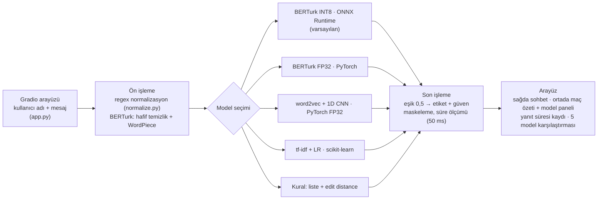

# FurkanSports · Maç Sohbeti Moderasyonu

**SWE015 – Introduction to Large Language Models · Ödev · Use Case 4: Real-Time Chat Moderation**
Furkan Canik

Canlı maç yayını sohbetindeki Türkçe mesajları **CPU üzerinde, mesaj başına 50 ms bütçesiyle**
temiz / hakaret olarak etiketleyen bir uygulama. Hakaret içeren mesajlar maskelenir, her mesajın
yanıt süresi kaydedilir ve kullanıcı beş model arasında geçiş yapabilir. Uygulamada varsayılan
olarak **INT8 quantize edilmiş BERTurk** çalışır.

- **Kod:** https://github.com/furkancanik/mac-moderasyon
- **Eğitilmiş modeller:** https://huggingface.co/furkancanik1905/mac-moderasyon-models
- **Demo videosu (2 dk):** _[link eklenecek]_

## Model merdiveni

| # | Model | Alan | Dosya |
|---|---|---|---|
| 1a | Kural: küfür listesi + minimum edit distance | B · Klasik NLP | `src/lexicon.py` |
| 1b | tf-idf (kelime 1–2 gram + karakter 2–5 gram) + logistic regression | B · Klasik NLP | `src/train_baselines.py` |
| 2 | Kendi word2vec’im (skip-gram) + 1D CNN + feedforward, SGD ile | A · Sinir ağları | `src/train_w2v_cnn.py` |
| 3 | BERTurk (`dbmdz/bert-base-turkish-cased`) fine-tune | C · Transformer | `src/train_bert.py` |
| 4 | Aynı BERTurk → ONNX → **dynamic INT8** (ONNX Runtime) | D · Verimli modeller | `src/quantize_bert.py` |

**Gecikme bütçesi:** CPU’da mesaj başına ortalama ≤ 50 ms.
**Uygulamada çalışan model:** BERTurk INT8 (ONNX Runtime, CPU).

## Sonuçlar

Aynı test seti (OffensEval-TR 2020, 3.528 tweet). Gecikme: tek mesaj, ön işleme dahil, 10 ısınma
turundan sonra 200 çalıştırmanın ortalaması. Donanım: **Apple M4, macOS, yalnızca CPU**.

| Model | Macro-F1 | Accuracy | Hakaret recall | Boyut (MB) | Gecikme ort. (ms) | p95 (ms) | 50 ms bütçesi |
|---|---|---|---|---|---|---|---|
| Kural: küfür listesi + edit distance | 0,671 | 0,842 | 0,297 | 0,001 | 0,018 | 0,041 | ✓ |
| tf-idf + logistic regression | 0,762 | 0,838 | 0,672 | 5,66 | 0,510 | 0,659 | ✓ |
| word2vec + 1D CNN | 0,727 | 0,838 | 0,496 | 12,64 | 0,114 | 0,139 | ✓ |
| BERTurk (PyTorch FP32) | 0,807 | 0,868 | 0,756 | 422,72 | 14,546 | 18,306 | ✓ |
| BERTurk (ONNX FP32) | 0,807 | 0,868 | 0,756 | 422,17 | 8,492 | 13,147 | ✓ |
| **BERTurk INT8 (ONNX), uygulamada** | **0,807** | **0,870** | **0,736** | **106,20** | **5,558** | **10,303** | **✓** |

Quantization modeli **4,0 kat küçülttü** ve PyTorch FP32’ye göre **2,6 kat hızlandırdı**; test
macro-F1 0,8072 → 0,8069. Ham sonuçlar: [`results/`](results/) (her model için bir JSON dosyası,
özet tablo: [`results/results_table.md`](results/results_table.md)).

## Mimari



Çıkarım yerel CPU’da çalışır; eğitim Apple GPU (MPS) üzerinde yapıldı. Model dosyaları ilk
çalıştırmada Hugging Face Hub’dan indirilir (`src/models_hub.py`). Maç listesindeki videolar resmi
yayıncıların YouTube özetleridir; uygulamaya yalnızca gömülür, indirilmez.

## Uygulamayı çalıştırma

Python 3.10–3.13 ile test edildi.

```bash
git clone https://github.com/furkancanik/mac-moderasyon.git
cd mac-moderasyon
python -m venv .venv
source .venv/bin/activate          # Windows: .venv\Scripts\activate
pip install -r requirements.txt    # NVIDIA GPU ile eğitim için önce CUDA'lı torch kurulabilir
python app.py
```

Tarayıcıda **http://127.0.0.1:7860** açılır. Eksik model dosyaları ilk çalıştırmada
[Hugging Face Hub](https://huggingface.co/furkancanik1905/mac-moderasyon-models)’dan otomatik
indirilir (yaklaşık 530 MB).

## Eğitimi ve sonuç tablosunu yeniden üretme

```bash
python -m src.check_env          # ortam ve GPU kontrolü
python -m src.prepare_data       # veriyi indir, data/ altına CSV olarak kaydet
python -m src.train_baselines    # kural + tf-idf
python -m src.train_w2v_cnn      # word2vec + 1D CNN
python -m src.train_bert         # BERTurk fine-tune (GPU/MPS önerilir)
python -m src.quantize_bert      # ONNX'e aktarma + INT8 quantization
python -m src.show_results       # sonuç tablosu -> results/results_table.md
```

## Teknik haritası

| Alan | Teknikler | Bileşen |
|---|---|---|
| A · Sinir ağları | 1D CNN (konvolüsyon + max pooling), feedforward katman, SGD + backpropagation, dropout | `w2v_cnn.py`, `train_w2v_cnn.py` |
| B · Klasik NLP | Regex normalizasyon (leetspeak, tekrarlı harf, Türkçe harfler), minimum edit distance, tf-idf, word2vec | `normalize.py`, `lexicon.py`, `train_baselines.py` |
| C · Transformer | BERTurk fine-tuning, self-attention, WordPiece tokenizer | `bert_model.py`, `train_bert.py` |
| D · Verimli modeller | ONNX’e aktarma, dynamic INT8 quantization, 50 ms gecikme bütçesi, boyut/gecikme ölçümü | `quantize_bert.py`, `evaluate.py` |

## Veri

- **OffensEval-TR 2020** (Çöltekin, 2020): eğitim 30.000, dev 1.756, test 3.528 tweet; etiketler
  `0 = temiz (NOT)`, `1 = hakaret (OFF)`. Test setindeki hakaret oranı %20,3.
- Kaynak: Çağrı Çöltekin. 2020. *A Corpus of Turkish Offensive Language on Social Media.* LREC 2020.
  Bölümlenmiş sürüm: [stefan-it/offenseval2020_tr](https://huggingface.co/datasets/stefan-it/offenseval2020_tr) · Lisans: CC-BY.
- Küfür listesi (`src/lexicon_tr.txt`) bu proje için elle hazırlandı.
- **İçerik uyarısı:** veri seti ve küfür listesi hakaret ve küfür içerir.

## Klasör yapısı

```
mac-moderasyon/
├── app.py                 Gradio uygulaması (FurkanSports arayüzü)
├── requirements.txt
├── src/
│   ├── check_env.py       ortam kontrolü
│   ├── prepare_data.py    veri indirme ve bölümleme
│   ├── normalize.py       regex normalizasyon
│   ├── lexicon.py         edit distance ile küfür listesi eşleştirme
│   ├── lexicon_tr.txt     küfür listesi
│   ├── train_baselines.py kural + tf-idf baseline
│   ├── w2v_cnn.py         word2vec + 1D CNN modeli
│   ├── train_w2v_cnn.py   word2vec ve CNN eğitimi
│   ├── bert_model.py      BERTurk sınıflandırıcıları (PyTorch / ONNX)
│   ├── train_bert.py      BERTurk fine-tuning
│   ├── quantize_bert.py   ONNX'e aktarma + INT8 quantization
│   ├── evaluate.py        metrikler ve gecikme ölçümü
│   ├── predictors.py      uygulamanın kullandığı model arayüzü
│   ├── models_hub.py      Hugging Face Hub indirme / yükleme
│   └── show_results.py    sonuç tablosu
├── results/               ölçüm sonuçları (JSON + tablo)
├── assets/                yerel görseller (repoya eklenmez)
├── data/                  indirilen veri (repoya eklenmez)
└── models/                eğitilmiş modeller (repoya eklenmez, HF Hub'da)
```

## Yapay zekâ kullanımı

Kod yazımı, hata ayıklama, bu README ve sunum taslağı için Claude (Anthropic) kullanıldı. Bütün
eğitimler ve ölçümler kendi bilgisayarımda (Apple M4) çalıştırıldı; tablodaki sayılar
`results/*.json` dosyalarından gelir.
