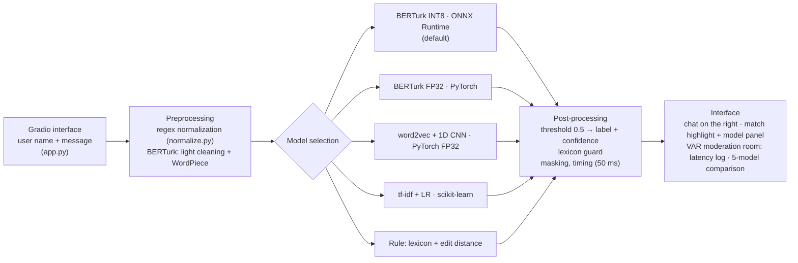

# FurkanSports · Match Chat Moderation

**SWE015 – Introduction to Large Language Models · Homework · Use Case 4: Real-Time Chat Moderation**
Furkan Canik · 220901570

An application that labels Turkish live-football chat messages as **clean / offensive on a CPU,
within a 50 ms budget per message**. Offensive messages are masked, the response time of every
message is logged, and the user can switch between five models. By default the app runs the
**INT8 quantized BERTurk**.

- **Code:** https://github.com/furkancanik/mac-moderasyon
- **Trained models:** https://huggingface.co/furkancanik1905/mac-moderasyon-models
- **Demo video (2 min):** _[link to be added]_

## Model ladder

| # | Model | Area | File |
|---|---|---|---|
| 1a | Rule: swear-word lexicon + minimum edit distance | B · Classical NLP | `src/lexicon.py` |
| 1b | tf-idf (word 1–2 grams + char 2–5 grams) + logistic regression | B · Classical NLP | `src/train_baselines.py` |
| 2 | My own word2vec (skip-gram) + 1D CNN + feedforward, trained with SGD | A · Neural networks | `src/train_w2v_cnn.py` |
| 3 | BERTurk (`dbmdz/bert-base-turkish-cased`) fine-tuned | C · Transformers | `src/train_bert.py` |
| 4 | The same BERTurk → ONNX → **dynamic INT8** (ONNX Runtime) | D · Efficient models | `src/quantize_bert.py` |

**Latency budget:** mean ≤ 50 ms per message on CPU.
**Model used in the app:** BERTurk INT8 (ONNX Runtime, CPU).

## Results

Same test set (OffensEval-TR 2020, 3,528 tweets). Latency: one message at a time, preprocessing
included, mean of 200 runs after 10 warm-up runs. Hardware: **Apple M4, macOS, CPU only**.

| Model | Macro-F1 | Accuracy | Offensive recall | Size (MB) | Mean latency (ms) | p95 (ms) | 50 ms budget |
|---|---|---|---|---|---|---|---|
| Rule: lexicon + edit distance | 0.671 | 0.842 | 0.297 | 0.001 | 0.018 | 0.041 | ✓ |
| tf-idf + logistic regression | 0.762 | 0.838 | 0.672 | 5.66 | 0.510 | 0.659 | ✓ |
| word2vec + 1D CNN | 0.727 | 0.838 | 0.496 | 12.64 | 0.114 | 0.139 | ✓ |
| BERTurk (PyTorch FP32) | 0.807 | 0.868 | 0.756 | 422.72 | 14.546 | 18.306 | ✓ |
| BERTurk (ONNX FP32) | 0.807 | 0.868 | 0.756 | 422.17 | 8.492 | 13.147 | ✓ |
| **BERTurk INT8 (ONNX), in the app** | **0.807** | **0.870** | **0.736** | **106.20** | **5.558** | **10.303** | **✓** |

Quantization made the model **4.0× smaller** and **2.6× faster** than PyTorch FP32; test macro-F1
went from 0.8072 to 0.8069. Raw results: [`results/`](results/) (one JSON file per model; summary
table: [`results/results_table.md`](results/results_table.md)).

## Architecture



**Lexicon guard:** BERTurk rarely saw spellings like “s4l4k” during training, so it can miss them.
In the app, if the normalized message matches the swear-word lexicon, the message is labeled
offensive even when the model says clean, and the interface marks it as “küfür listesi”
(swear-word list). The numbers in the results table were measured on the models alone, without
this guard.

Inference runs on the local CPU; training was done on an Apple GPU (MPS). Model files are downloaded
from the Hugging Face Hub on the first run (`src/models_hub.py`). The videos in the match list are
official broadcasters’ YouTube highlights; they are only embedded, never downloaded.

## Run the application

Tested with Python 3.10–3.13.

```bash
git clone https://github.com/furkancanik/mac-moderasyon.git
cd mac-moderasyon
python -m venv .venv
source .venv/bin/activate          # Windows: .venv\Scripts\activate
pip install -r requirements.txt    # for NVIDIA GPU training, install a CUDA build of torch first
python app.py
```

The app opens at **http://127.0.0.1:7860**. Missing model files are downloaded automatically
from the [Hugging Face Hub](https://huggingface.co/furkancanik1905/mac-moderasyon-models) on the
first run (about 530 MB).

## Reproduce training and the results table

```bash
python -m src.check_env          # environment and GPU check
python -m src.prepare_data       # download the data, save CSVs under data/
python -m src.train_baselines    # rule + tf-idf
python -m src.train_w2v_cnn      # word2vec + 1D CNN
python -m src.train_bert         # BERTurk fine-tuning (GPU/MPS recommended)
python -m src.quantize_bert      # ONNX export + INT8 quantization
python -m src.show_results       # results table -> results/results_table.md
```

## Technique map

| Area | Techniques | Component |
|---|---|---|
| A · Neural networks | 1D CNN (convolution + max pooling), feedforward layer, SGD + backpropagation, dropout | `w2v_cnn.py`, `train_w2v_cnn.py` |
| B · Classical NLP | Regex normalization (leetspeak, repeated letters, Turkish characters), minimum edit distance, tf-idf, word2vec | `normalize.py`, `lexicon.py`, `train_baselines.py` |
| C · Transformers | BERTurk fine-tuning, self-attention, WordPiece tokenizer | `bert_model.py`, `train_bert.py` |
| D · Efficient models | ONNX export, dynamic INT8 quantization, 50 ms latency budget, size/latency benchmarking | `quantize_bert.py`, `evaluate.py` |

## Data

- **OffensEval-TR 2020** (Çöltekin, 2020): 30,000 train, 1,756 dev and 3,528 test tweets; labels
  `0 = clean (NOT)`, `1 = offensive (OFF)`. 20.3% of the test set is offensive.
- Source: Çağrı Çöltekin. 2020. *A Corpus of Turkish Offensive Language on Social Media.* LREC 2020.
  Split version: [stefan-it/offenseval2020_tr](https://huggingface.co/datasets/stefan-it/offenseval2020_tr) · License: CC-BY.
- The swear-word lexicon (`src/lexicon_tr.txt`) was written by hand for this project.
- **Content warning:** the dataset and the lexicon contain offensive language.

## Repository layout

```
mac-moderasyon/
├── app.py                 Gradio app (FurkanSports interface)
├── requirements.txt
├── src/
│   ├── check_env.py       environment check
│   ├── prepare_data.py    data download and splits
│   ├── normalize.py       regex normalization
│   ├── lexicon.py         lexicon matching with edit distance
│   ├── lexicon_tr.txt     swear-word lexicon
│   ├── train_baselines.py rule + tf-idf baselines
│   ├── w2v_cnn.py         word2vec + 1D CNN model
│   ├── train_w2v_cnn.py   word2vec and CNN training
│   ├── bert_model.py      BERTurk classifiers (PyTorch / ONNX)
│   ├── train_bert.py      BERTurk fine-tuning
│   ├── quantize_bert.py   ONNX export + INT8 quantization
│   ├── evaluate.py        metrics and latency benchmarking
│   ├── predictors.py      model interface used by the app (incl. lexicon guard)
│   ├── models_hub.py      Hugging Face Hub download / upload
│   └── show_results.py    results table
├── results/               measured results (JSON + table)
├── assets/                local images (not committed)
├── data/                  downloaded data (not committed)
└── models/                trained models (not committed; on the HF Hub)
```

## AI usage

Claude (Anthropic) was used for writing code, debugging, this README and the slide draft. All
training and measurements were run on my own computer (Apple M4); the numbers in the tables come
from `results/*.json`.
